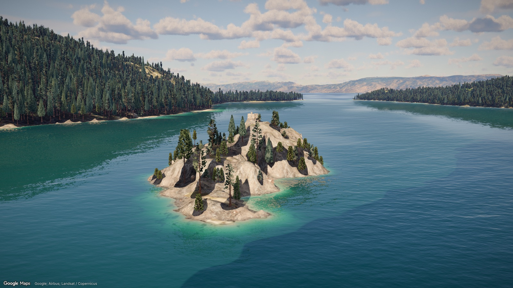
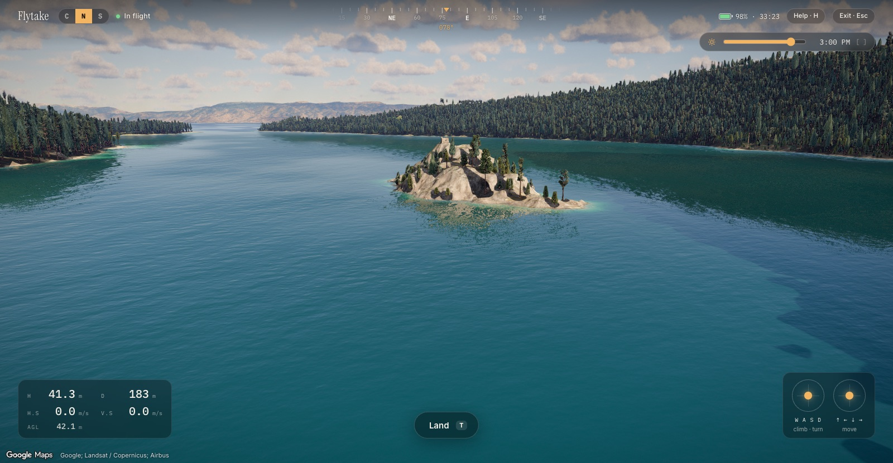
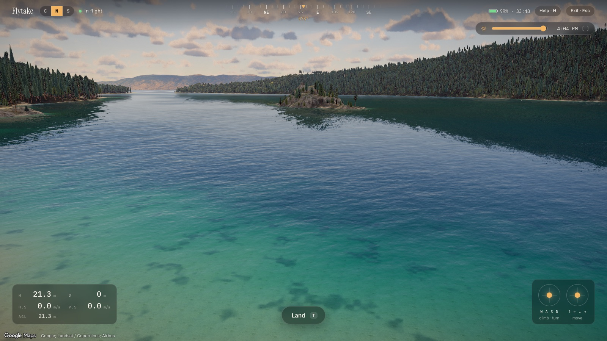

# Flytake

**Learn drone cinematography in a real place, before you fly there.** Flytake drops you from
orbit onto Lake Tahoe's Emerald Bay and hands you a camera drone with DJI-style controls. The
bay itself is a game-quality 3D scene rebuilt from public lidar, imagery and terrain data, and
the sun moves in real time.

Built for the Zero to Demo hackathon (Nov 7, 2026). The AI coaching layer (shot feedback) is
the next step. This repo is the flight simulator and the world it flies in.



| Drone view, 3:00 PM | Same view, 4:04 PM (the ridge shadow reaches the bay) |
| --- | --- |
|  |  |

## What it does

1. **Descent from space.** The start screen shows the Earth from 24,000 km. Press **Fly** for
   a 14-second descent through a physically based atmosphere to Emerald Bay.
2. **Fly a drone.** A DJI Mini 4 Pro-class drone starts on Vikingsholm Beach. It has a Mode 2
   keyboard or gamepad layout, a velocity-commanded flight model, obstacle braking, crashes and
   splashdowns, a battery and a pilot HUD.
3. **Change the time of day.** Drag the slider or hold `[` / `]` to move the sun between
   7:15 AM and 4:24 PM on Nov 7. Terrain, ridge and tree shadows, the water and the sky all
   update live at 60 fps.
4. **Fly San Francisco.** The same drone takes off behind the Ferry Building, with the Bay
   Bridge across the water. It needs no key (see [San Francisco](#san-francisco-ferry-building)).

Inside an 8 km box around the bay, everything is custom. Outside it, Google Photorealistic 3D
Tiles show the rest of Lake Tahoe and the planet.

## Quick start

Requirements:
- Node 22+ (developed on Node 26) and pnpm 10+ (developed on pnpm 11).
- Desktop Chrome with a decent GPU. It runs at 60 fps on an Apple M4 Max and has not been tested
  on integrated laptop GPUs (see [Performance](#performance)).
- About 500 MB of disk space. The generated Emerald Bay scene (`public/scene`, ~420 MB) is
  committed so the app runs without the data pipeline.

```sh
git clone https://github.com/icecreamlun/Flytake.git
cd Flytake
pnpm install
cp .env.example .env.local   # then fill in ONE of the two keys below
pnpm dev                     # open http://localhost:5173
```

Put one of these keys in `.env.local`. The file is gitignored, so never commit it.

| Variable | What it is |
| --- | --- |
| `VITE_GOOGLE_MAPS_API_KEY` | Google Cloud key with the **Map Tiles API** enabled. It is sent to the browser, so restrict it to that API and your HTTP referrers. |
| `VITE_CESIUM_ION_TOKEN` | Cesium ion token, used only if the Google key is empty. Flytake loads ion asset 2275207 (Google Photorealistic 3D Tiles). |

Without a key the app still starts. It shows the sky, stars and a stand-in globe behind a card
with these setup steps.

Shortcuts:
- http://localhost:5173/?drone=1 skips the descent and starts on the beach with the drone.
- http://localhost:5173/?drone=1&time=8.5 does the same at 8:30 AM.
- http://localhost:5173/?loc=sf flies San Francisco from the Ferry Building. No key needed.

## Using it

### Start screen and descent

- Pick **Emerald Bay, Lake Tahoe** (the only location so far) and press **Fly**.
- The arrival view preloads in the background. If you click before it is ready, the button
  shows **Preparing** and the flight starts by itself once it is (at most ~25 s).
- The HUD shows altitude, position, gimbal pitch and heading during the flight. **Skip** jumps
  to the arrival.
- After arrival, drag or scroll to take over the camera:
  - drag to pan;
  - right-drag or Shift-drag to orbit;
  - scroll to zoom.
- **Replay** flies the descent again. **Fly a drone here** switches to the drone.

### Drone controls (Mode 2, like a DJI remote)

| Keys | Gamepad | Action |
| --- | --- | --- |
| `T` | A | take off (auto-climb to 1.2 m) / land / cancel landing |
| `W` `S` | left stick ↕ | climb / descend |
| `A` `D` | left stick ↔ | turn left / right |
| `↑` `↓` | right stick ↕ | forward / back |
| `←` `→` | right stick ↔ | slide left / right |
| `K` `M` | RT / LT | camera tilt up / down (gimbal, −90° to +60°) |
| `1` `2` `3` | LB / RB | Cine 5 m/s · Normal 12 m/s · Sport 16 m/s |
| `[` `]` | | time of day earlier / later (hold to sweep) |
| `G` | Y | rule-of-thirds grid |
| `N` | | mute the motors |
| `H` / `?` | View | show / hide the controls help |
| `R` | B | reset to the launch point (after a crash or once landed) |
| `Esc` | Menu | leave the drone (map controls take over from the drone's view) |

How the drone behaves:
- **Flight model.** Velocity-commanded, with per-mode acceleration and expo
  (`src/drone/physics.ts`, unit-tested). Keyboard axes ramp like spring-centred sticks.
- **Camera.** Gimbal-stabilised with a level horizon. It starts at a −12° tilt; `K` / `M` tilt it
  between −90° (straight down) and +60°, faster in Sport and slower in Cine. GIM on the HUD shows
  the angle.
- **Collisions.** Every frame the drone is ray-cast against the terrain, water, trees and
  buildings.
  - Normal and Cine modes brake for obstacles ahead.
  - Sport mode has no obstacle sensing, like the real drone, so flying into a tree is a crash.
  - Landing on the lake is a splashdown.
  - Height is capped at 120 m above the take-off point.
- **HUD.**
  - H: height above take-off; D: distance from home; H.S / V.S: horizontal and vertical speed.
  - Height above ground.
  - Compass tape with a home marker.
  - Battery (34 min) and live stick positions.

## The Emerald Bay scene

Google's photogrammetry looks like crumpled paper at drone height: blobby trees and a lake
surface draped over the reconstructed lake bottom. So inside an 8 km × 7.7 km box around the
bay, Flytake replaces it with a scene built like a game level from public data.

| Layer | How it is made | Code |
| --- | --- | --- |
| **Sun and shadows** | One time-of-day store drives the atmosphere, every material and a GPU shadow field. The ground (2 m DTM) and every lidar tree crown are drawn into a height map, which is marched toward the sun whenever the sun moves. A 0.5 m near field around the camera keeps tree shadows sharp. | `src/world/sun.ts`, `src/world/shadowField.ts` |
| **Terrain** | USGS 3DEP 1 m bare-earth DEM, streamed as a 6-level 3D Tiles quadtree of RTIN meshes. Each tile carries albedo, sky occlusion and an ENU normal map whose alpha holds lidar roughness. | `src/world/Terrain.tsx`, `tools/scene` |
| **Ground materials** | NAIP 2022 0.6 m imagery gives the regional colour (tree crowns painted out). Five CC0 materials (sand, decomposed-granite gravel, pine needles, granite, dry ground) are height-blended by slope, roughness, height above the lake and canopy. | `src/world/Terrain.tsx`, `public/textures/terrain` |
| **Fannette Island** | The DEM's hydro-flattening erased the island, so it is rebuilt from the full-density point cloud. The 1929 stone Tea House ruin sits on its summit; it casts shadows and the drone collides with it. | `tools/scene/island_ground.py`, `src/world/TeaHouse.tsx` |
| **Ground cover** | Boulders, pebbles, grass, manzanita, logs and driftwood are streamed around the camera. Placement comes from the terrain classes and avoids OSM roads and buildings. | `src/ground` |
| **Forest** | 362k trees, each detected in the lidar canopy height model, drawn as procedural Sierra conifers (white / red fir, Jeffrey pine, lodgepole pine, snags). They use instanced LODs and runtime-lit impostors. | `src/forest` |
| **Water** | Animated multi-scale FFT waves, a sky probe plus planar reflections, and sun glitter. Depth colour runs from turquoise shallows to emerald bay to sapphire lake, with caustics and a wet shoreline. | `src/world/waterShading.ts`, `tools/water` |
| **Sky** | Precomputed physical atmosphere plus volumetric clouds that cast ground shadows. | `src/scene/Experience.tsx`, `src/scene/SkyClouds.tsx` |

Frames and seams:
- Everything lives in the ENU frame of Fannette Island (`src/world/scene.ts`).
- Google tiles are discarded inside the box with a dithered edge (`src/world/clip.ts`).

Rules for anyone adding to the scene:
- **Never use raw ECEF vertices.** World space is ECEF and the tiles group is never rotated, so
  camera poses, the atmosphere and flight paths share one frame. Put custom geometry under the
  scene frame (`SCENE_FRAME`) or `enuFrameAt()`; raw float32 ECEF vertices jitter.
- **Output pre-lit albedo.** takram's aerial-perspective pass relights every pixel by sun
  irradiance × flat N·L. Custom materials therefore output
  `albedo * (direct * sunColor + ambient * ao) * uFlatSunInv`, using the uniforms in
  `src/world/light.ts`. Get sun visibility from `flySunVis()` in `src/world/shadowGlsl.ts`.

## San Francisco (Ferry Building)

Open http://localhost:5173/?loc=sf, or type "sf", "ferry" or "bay bridge" on the start screen.
It needs no Google or Cesium key, because everything is local (`public/sf`, ~13 MB). The setup
card has a **Fly San Francisco** button too.

What is there:
- The Financial District and the waterfront in a 3 × 2.4 km box: 5,689 buildings with roofs
  and rooftop detail, streets with traffic and streetcars, palms and street trees, and the
  piers.
- Hand-built landmarks: the Ferry Building and its clock tower, the Bay Bridge's west span,
  the pier sheds, Transamerica, Coit Tower and Old St. Mary's.
- The bay, a physical sky, sun shadows, and distant hills with Golden Gate and Alcatraz
  silhouettes.

How it works:
- The drone takes off from Ferry Plaza, the paved apron behind the Ferry Building, facing the
  bridge.
- It uses the same flight model, HUD, sound and time-of-day slider as Emerald Bay. Normal and
  Cine modes brake at walls; Sport mode crashes into them. Landing on the bay is a splashdown.
- `Esc` switches to a free orbit camera (drag to orbit, right-drag to pan, scroll to zoom).
  `T`, `Enter` or **Fly drone** puts the drone back on the plaza, landed (press `T` to take off).

**Preview flight** (`P`) shows a hard-coded flight plan from Ferry Plaza as a dashed line in the city,
then plays it as a 60 s letterboxed shot at 4 PM: a pull-away from the clock tower, an arc round
to its sunlit west face with the Bay Bridge behind, and a climb over the tower out toward the bridge
(`src/sf/previewRoute.ts`). `Esc` ends it early. Afterwards the drone is back on the plaza and the
plan stays drawn, so you can fly it by hand.
- The page runs on its own engine: the city and renderer from
  [argus](https://github.com/icecreamlun/argus) (vanilla three.js, n8ao, physical sky),
  ported to `src/sf/argus`. It is code-split, so the Emerald Bay page never loads it.
- The drone collides with three-mesh-bvh bounds trees over the static city: ground, piers,
  building walls and roofs, and the landmarks including the bridge (`src/sf/collision.ts`).

Credits: buildings, streets and piers © OpenStreetMap contributors (ODbL). DataSF (PDDL)
provides the building footprints with 2010 LiDAR heights, the SF Assessor tax rolls and the
street trees. Terrain and bathymetry come from AWS Terrain Tiles (USGS 3DEP and NOAA). The
city model was ported from argus. Details are in `public/sf/data/SOURCES.md`.

## Project layout

```
src/
  config.ts          keys, URL flags, atmosphere date
  debug.ts           window.__flytake automation / debug handle
  geo/               WGS84 helpers (ECEF, ENU, heading/pitch/roll), Tahoe POIs, ENU frames
  camera/            descent trajectory (+ tests), idle motion, destinations, cue timeline
  drone/             flight model (+ tests), keyboard / gamepad input, motor sound, DroneSim
  scene/             R3F scene: Google tiles globe, camera director, atmosphere, clouds, post FX
  world/             Emerald Bay: sun + shadow field, terrain tiles, water, Tea House, clipping
  forest/            procedural conifers, instanced LOD + impostor forest, tree collisions
  ground/            streamed ground cover (rocks, grass, shrubs, logs)
  state/store.ts     zustand app state (phases, flight control, readiness)
  ui/                start screen, HUDs, time-of-day slider, letterbox, title card, attribution
  sf/                San Francisco (/?loc=sf): app, drone, collision; argus/ is the ported city engine
public/
  scene/             generated Emerald Bay data: terrain tiles, dtm.bin, trees.bin, ground cover
  textures/          terrain materials, forest, ground props, water (waves + lake depth)
  atmosphere/        precomputed atmosphere tables + star catalogue
  clouds/            cloud shape / weather textures
  sf/                San Francisco city data (city.json, terrain) and water normals
tools/
  scene/             Python pipeline: lidar / DEM / NAIP -> public/scene
  water/             wave and lake-depth textures -> public/textures/water
docs/                README screenshots
forest.html          forest look-dev page (dev server only)
```

## Rebuilding the scene data

You only need this to change the scene. The generated output is already in `public/`.

- **Steps.** The pipeline is Python 3.12 (numpy, scipy, rasterio, pyproj, laspy, …).
  [`tools/scene/README.md`](tools/scene/README.md) has the full sequence.
- **Data volume.** Raw downloads and intermediate rasters (~5 GB) go to `../Flytake-data`
  (override with `FLYTAKE_DATA`).
- **Other assets.** See [`tools/water/README.md`](tools/water/README.md),
  [`src/forest/README.md`](src/forest/README.md) (tree textures) and
  [`src/ground/README.md`](src/ground/README.md) (ground-cover props).
- **Ground cover.** Re-run `tools/scene/ground_classes.py` whenever the terrain changes, or the
  rocks and grass will float or sink.

## Development

| Command | What it does |
| --- | --- |
| `pnpm dev` | dev server on http://localhost:5173 |
| `pnpm build` | type-check (`tsc -b`) and build to `dist/` |
| `pnpm preview` | serve the production build |
| `pnpm test` | Vitest: descent trajectory, geodesy, drone flight model, forest and ground placement, HUD formatting |
| `pnpm typecheck` | TypeScript only |

### URL flags

Start and camera:

| Flag | Effect |
| --- | --- |
| `?loc=sf` | San Francisco: drone at the Ferry Building, no key needed (`&time=` works too) |
| `?drone=1` | start in drone mode on Vikingsholm Beach |
| `?launch=38.9531,-120.1068,78` | drone launch site override (lat, lon, optional heading) |
| `?time=8.5` | initial time of day in PST hours on Nov 7 (7.25 to 16.4) |
| `?autoplay=1` | skip the start screen and fly as soon as the scene is ready |
| `?t=0.8` | freeze the descent at that fraction of its 14 s |
| `?pose=hero` | jump to the arrival pose and hold it |
| `?noui=1` | hide the overlays (the Google attribution stays) |

Quality and performance:

| Flag | Effect |
| --- | --- |
| `?stats=1` | fps and tile counters |
| `?dpr=2` | pixel-ratio cap (default 1.5; drops automatically below 40 fps) |
| `?error=16` | Google tiles screen-space error in CSS px (default 12; higher is lighter) |
| `?clouds=0` / `?clouds=low\|medium\|high\|ultra` | volumetric clouds off / quality |
| `?ground=0` | no ground cover |

Scene A/B and debug views:

| Flag | Effect |
| --- | --- |
| `?scene=0` | Google tiles only (no custom Emerald Bay scene) |
| `?terrain=debug\|shadow\|mat` | terrain debug colours / live sun visibility / ground-material weights |
| `?water2=0` | the previous water shading |
| `?water=0\|debug\|blur`, `?watertol=0.2` | Google-tile lake recolouring off / its mask / blurred sample; lake-level tolerance |
| `?haze=0` | unpatched aerial-perspective haze near the ground |
| `?exposure=1.2` | multiply the scripted exposure |
| `?light=sunsky`, `?tm=aces`, `?albedo=1`, `?sat=0.1`, `?contrast=0.1`, `?normals=generated` | look-dev A/B |

### Debug handle

`window.__flytake` exposes:
- state: `state` (`loading | start | flying | arrived | free | drone`), `progress`,
  `tilesLoading`, `stats()`;
- descent: `jump(t)`, `fly()`, `replay()`, `handoff()`;
- drone: `enterDrone()`, `exitDrone()`, `drone()`;
- scene: `time` (get/set, PST hours), `pose(eyeEnu, targetEnu)`, `groundAtEnu(e, n)`,
  `surfaceAt(lat, lon)`.

On `/?loc=sf`, `window.__sf` exposes `ready`, `state`, `drone()` (the same fields plus
`x`/`y`/`z` in the city frame: +X east, +Y up, +Z south), `time`, `fly()`, `exitDrone()`,
`cast(origin, dir, far)`, and the live `engine`, `city` and `collider`.

## Performance

| Situation | Measured |
| --- | --- |
| Flying, hovering or scrubbing the time | 60 fps (Apple M4 Max, Chrome, 1600×900, default settings) |
| Drone ready after page load | 9–15 s |

Not yet tested on integrated laptop GPUs. If a machine struggles, try these lighter settings:
- `?clouds=low`
- `?ground=0`
- `?dpr=1`
- `?error=16`

For a demo, open the page on a Retina screen with `?dpr=2` for the sharpest trees.

## Known limitations

Water:
- Lake depth is estimated from the shoreline slope; there is no bathymetry.
- The water reflection's sky probe has no clouds.
- Cascade Lake and small ponds are shaded as land.

Scene detail:
- Ground-cover props (rocks, grass) do not cast shadows or appear in reflections.
- Jeffrey pines look slightly fan-like at 40–100 m, and all tree trunks are plain cylinders.
- The Tea House is modelled from photos and simplified.
- Right at the launch point (0.2 m above the sand) the beach looks flat. It reads correctly
  from a few metres up.

Seams and console:
- A faint dithered seam is visible at the edge of the 8 km box from high views.
- three.js warns in the console that `THREE.Clock` is deprecated. The warning comes from
  React Three Fiber and is harmless.

## Data sources and credits

| What | Source | Licence |
| --- | --- | --- |
| 1 m bare-earth DEM | USGS 3DEP (`CA_SierraNevada_B22`) | public domain |
| Lidar point cloud | USGS 3DEP `CA_SierraNevada_5_2022` (Entwine EPT, AWS `usgs-lidar-public`) | public domain |
| Aerial imagery | USDA NAIP 2022 California (Microsoft Planetary Computer) | public domain |
| Terrain materials and ground-cover scans | [Poly Haven](https://polyhaven.com) | CC0 |
| Roads, paths and buildings (prop placement only) | © OpenStreetMap contributors | ODbL |
| Foliage and bark textures | [ez-tree](https://github.com/dgreenheck/ez-tree) by Daniel Greenheck; bark from TextureCan | MIT; CC0 |
| Atmosphere, clouds, stars | [@takram/three-atmosphere, three-clouds](https://github.com/takram-design-engineering/three-geospatial) | MIT |
| Rest of the world | Google Photorealistic 3D Tiles, streamed at runtime and never stored in this repo | Google Maps Platform terms; attribution shown on screen |
| San Francisco buildings, streets, piers | © OpenStreetMap contributors | ODbL |
| San Francisco footprints + LiDAR heights, Assessor rolls, street trees | DataSF | PDDL |
| San Francisco terrain and bay bathymetry | AWS Terrain Tiles (USGS 3DEP, NOAA) | public domain / open data |
| San Francisco city model and renderer | [argus](https://github.com/icecreamlun/argus), ported to `src/sf/argus` | same author |

Per-asset details are in the READMEs under `src/forest`, `src/ground`, `tools/scene` and
`tools/water`.
